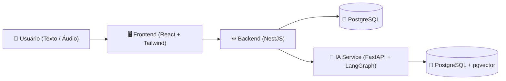

<div align="center">

# ✨ Agente Aghata ✨

**Assistente conversacional interativa para o dia a dia, com personalidade pop, humor e comunicação inclusiva.**


</div>

---

## 💜 Sobre o Projeto

A **Agente Aghata** é uma agente conversacional pensada para o **uso comum no dia a dia**, unindo utilidade prática de uma assistente pessoal com uma identidade leve, divertida e acolhedora.

- 🎭 **Personalidade & Cultura Pop:** interações descontraídas inspiradas em memes do mundo pop, bom humor e respostas naturais.
- 🏳️‍🌈 **Comunicação Inclusiva:** utiliza expressões e referências da comunicação LGBT, promovendo representatividade e inclusão da comunidade no uso cotidiano da tecnologia.
- 🎙️ **Interação por Áudio:** projetada para oferecer comunicação em voz/áudio, funcionando como uma assistente pessoal interativa além do chat em texto.

---

## 🧩 Arquitetura

O repositório é organizado em uma arquitetura modular dividida por responsabilidades:

```text
agente-aghata/
├── backend/            # API principal, autenticação e regras de negócio (NestJS + PostgreSQL)
├── ia-service/         # Serviço de IA, orquestração do agente e embeddings (FastAPI + LangGraph)
├── frontend/           # Interface web conversacional (React + Tailwind CSS)
├── docker-compose.yml  # Orquestração dos containers (ia-service + PostgreSQL/pgvector)
└── LICENSE
```



---

## 🛠️ Linguagens e Tecnologias

### Linguagens Utilizadas
- **Python (`3.12+`)** — base do serviço de inteligência artificial, orquestração de agentes, ferramentas e manipulação de embeddings.
- **TypeScript / JavaScript** — utilizado no backend (NestJS) e no frontend (React), garantindo tipagem estática e produtividade.
- **SQL** — consultas relacionais e vetoriais no PostgreSQL.

### Stack por Serviço

| Camada | Tecnologias | Responsabilidade |
| :--- | :--- | :--- |
| **Frontend** | **React**, **Tailwind CSS** | Interface interativa de chat, experiência do usuário e controles de áudio |
| **Backend** | **NestJS**, **PostgreSQL** | API principal, autenticação, gestão de usuários e persistência de dados |
| **IA Service** | **FastAPI**, **LangChain**, **LangGraph**, **pgvector** | Fluxo do agente conversacional, ferramentas de personalidade, busca semântica e embeddings |
| **Infraestrutura** | **Docker**, **Docker Compose**, **uv** | Conteinerização, isolamento de ambientes e gerenciamento rápido de dependências Python |

---

## 🚀 Como Executar com Docker

### 1. Pré-requisitos
- [Docker](https://www.docker.com/) e **Docker Compose** instalados.
- Chave/endpoint de LLM configurados.

### 2. Configurar variáveis de ambiente
Crie o arquivo `.env` dentro de `ia-service/` tomando como base o modelo disponível:

```bash
cp ia-service/.env.exemple ia-service/.env
```

Preencha suas credenciais (como `AZURE_OPENAI_BASE_URL`, `AZURE_OPENAI_API_KEY`, `DATABASE_VECTOR`, `GLOBAL_SYSTEM_PROMPT` e `EXPRESSOES`).

### 3. Subir os containers
Na raiz do projeto, execute:

```bash
docker compose up --build
```

Após inicializar:
- **IA Service (FastAPI):** `http://127.0.0.1:8000`
  - Documentação interativa (Swagger): `http://127.0.0.1:8000/docs`
  - Health check: `GET http://127.0.0.1:8000/internal/health`
  - Chat com a Aghata: `POST http://127.0.0.1:8000/chat`
- **PostgreSQL + pgvector:** `127.0.0.1:5499`

---

## 📄 Licença

Este projeto está licenciado sob os termos do arquivo [LICENSE](./LICENSE).
